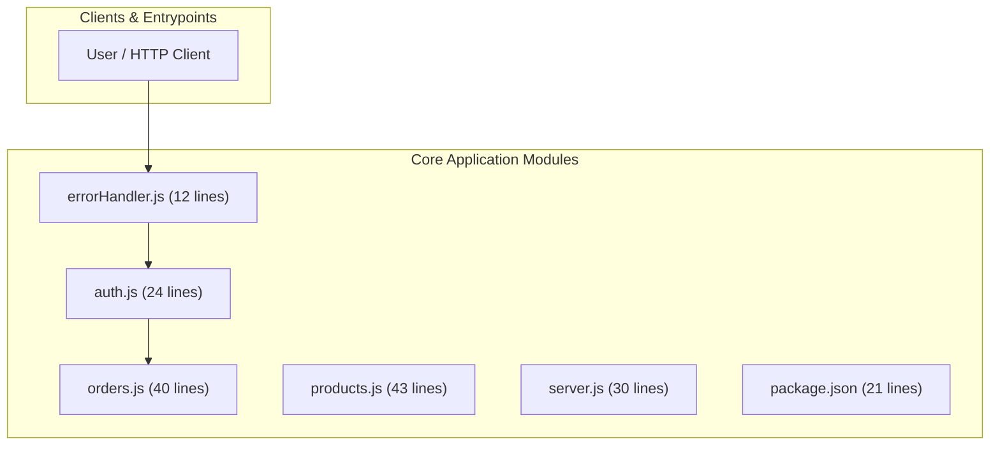
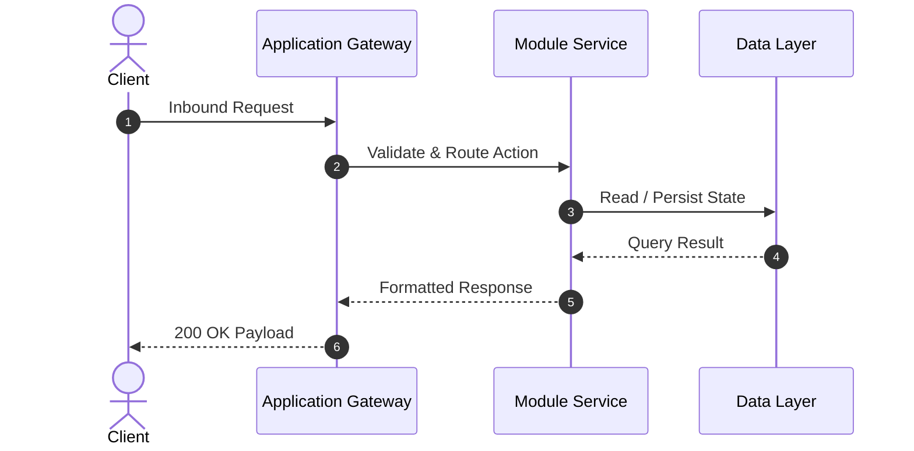

# 🚀 Structural Codebase Overview

This codebase contains **6 files** totaling **170 lines of code**.

### Primary Languages
- **JavaScript**: 149 lines (87.6%)
- **JSON**: 21 lines (12.4%)

# 📁 Codebase Directory Breakdown

| File Path | Language | Lines | Size |
| :--- | :--- | :--- | :--- |
| `src/middleware/errorHandler.js` | .js | 12 | 0.3 KB |
| `src/routes/auth.js` | .js | 24 | 0.6 KB |
| `src/routes/orders.js` | .js | 40 | 1.0 KB |
| `src/routes/products.js` | .js | 43 | 1.2 KB |
| `src/server.js` | .js | 30 | 0.8 KB |
| `package.json` | .json | 21 | 0.5 KB |

---

# 📐 System Architecture & Component Flow

### Component Dependency Graph

### Typical Execution Lifecycle

---

# 🔌 Discovered Endpoints & Symbols

| Type | Name / Signature | Source File | Line |
| :--- | :--- | :--- | :--- |
| `function` | **errorHandler** | `src/middleware/errorHandler.js` | L1 |
| `endpoint` | **POST /register** | `src/routes/auth.js` | L6 |
| `endpoint` | **POST /login** | `src/routes/auth.js` | L16 |
| `endpoint` | **POST /checkout** | `src/routes/orders.js` | L6 |
| `endpoint` | **GET /:id** | `src/routes/orders.js` | L26 |
| `endpoint` | **GET /** | `src/routes/products.js` | L6 |
| `endpoint` | **GET /:id** | `src/routes/products.js` | L23 |
| `endpoint` | **POST /** | `src/routes/products.js` | L32 |
| `endpoint` | **GET /health** | `src/server.js` | L15 |

---

# 🛠️ Codebase Health & Structural Audit

## Structural Metrics
- **Total Code Volume**: 170 lines across 6 scanned source files.
- **Language Composition**: JavaScript (149 lines), JSON (21 lines).
- **Extracted Symbols**: 9 endpoints, classes, and exported functions.
- **Internal Dependencies**: 9 module imports mapped.

## Health Observations
- **Modularity**: Code is split across 6 files with an average of 28 lines per file.
- **Documentation Coverage**: Ready for automated README and API documentation generation.
