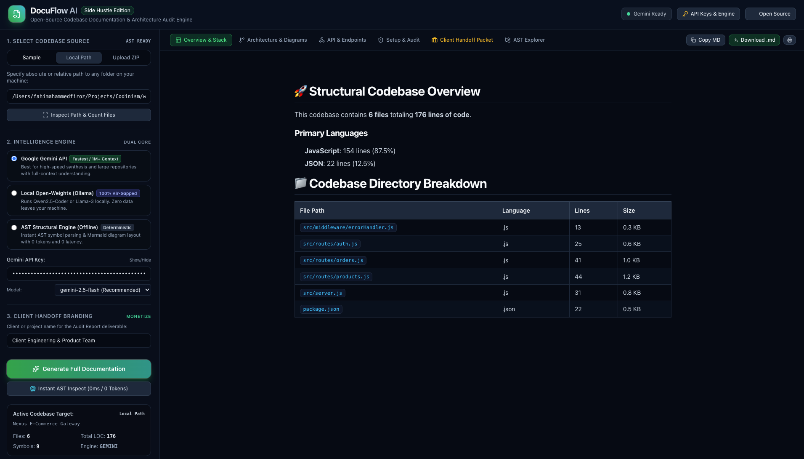
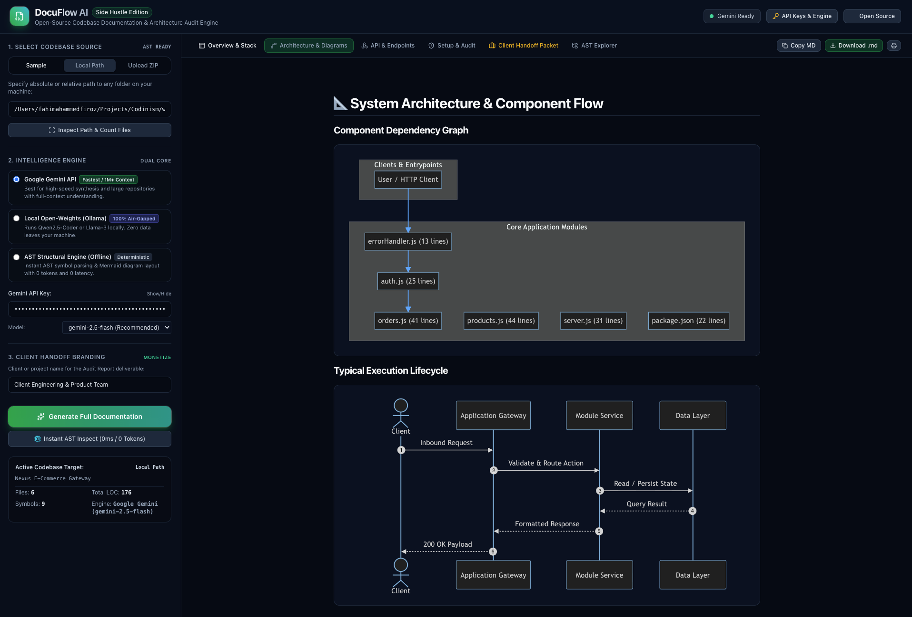
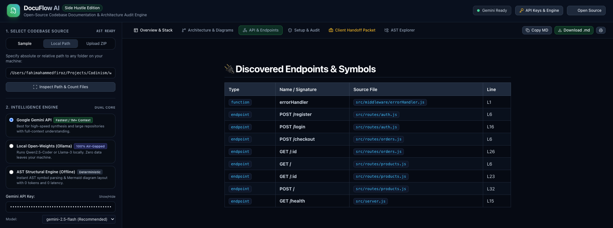
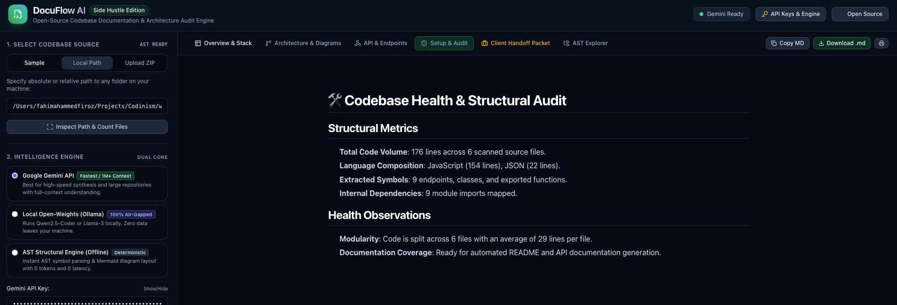

# ⚡ DocuFlow AI
### Autonomous Codebase Documentation & Architecture Engine with Open-Source AI at its Core

> **Week 2 Theme: Side Hustle** — *Build something with open-weight models or open-source AI that someone would actually pay for.*

[](https://github.com)
[](https://ai.google.dev)
[](https://ollama.com)
[](https://nodejs.org)
[](LICENSE)
[](https://dev.to/agent_sessions/building-docuflow-ai-autonomous-codebase-documentation-architecture-engine-pbjbtd)

---

> 🤖 **Agent Session Transcript**: The complete AI agentic build process has been preserved with DevRelay. Explore the raw prompts, tool calls, and decisions: [**View DevRelay Session #1054 on DEV.to**](https://dev.to/agent_sessions/building-docuflow-ai-autonomous-codebase-documentation-architecture-engine-pbjbtd).

---

## 💡 The Problem & The Side Hustle Opportunity

Every software developer, freelance consultant, and agency dreads the same scenario: you inherit a legacy codebase with **tens of thousands of lines of code**, **zero documentation**, **no architecture diagrams**, and **no API specs**. 

Engineering teams spend **25% to 35% of their working hours** reverse-engineering undocumented code, tracing route controllers, and deciphering messy module dependencies.

### 💰 The Business Model: *Codebase Audits as a Service*
**DocuFlow AI** turns this painful bottleneck into a lucrative, high-margin side hustle:
- Freelancers and agencies charge clients **\$200 to \$500 per repository audit**.
- With DocuFlow AI, you ingest any repository (via local path, drag-and-drop ZIP, or preloaded samples) and generate a **comprehensive, branded Client Handoff Packet** in seconds:
  1. **Executive Architecture Overview**: High-level system breakdown, design patterns, and tech stack analysis.
  2. **Interactive Mermaid.js Architecture & Sequence Diagrams**: Rendered live in-browser or exported as SVG.
  3. **Discovered API & Endpoint Specifications**: Every route, controller, parameter, and return signature mapped and cataloged.
  4. **Code Health & Security Audit**: Identified security vulnerabilities, missing validations, technical debt score, and deployment guides.
  5. **100% Client Privacy Guarantee**: Air-gapped AST parsing and local open-weight models ensure sensitive proprietary code never leaves the client's laptop.

---

## 📸 Product Walkthrough & UI Showcase

### 1. Executive Codebase Overview & Tech Stack Breakdown
Analyze project volume, language composition, core design patterns, and module structure with instant clarity.



---

### 2. Autonomous System Architecture & Mermaid Diagram Synthesis
Generate interactive, valid Mermaid.js component graphs and sequence flows representing the exact request lifecycle.



---

### 3. API & Endpoint Finder
Extract HTTP routes, controllers, middleware, function signatures, and payload shapes across Express, FastAPI, and Next.js applications.



---

### 4. Code Health, Tech Debt & Security Audit
Deliver enterprise-grade insights: security flags (CORS, unvalidated input, hardcoded secrets), maintainability scores, and actionable recommendations.



---

## 🔓 Why Open Innovation Matters For What We Built

### 1. 🛡️ Air-Gapped Code Privacy: Proprietary IP Never Leaves the Machine
Under SOC2, HIPAA, and standard client Non-Disclosure Agreements (NDAs), developers and agencies are legally prohibited from copying proprietary client code into commercial closed-source endpoints. 
- DocuFlow AI runs an **in-process open-source AST tokenizer** that parses files locally.
- For air-gapped environments, it connects out-of-the-box to **open-weight models** (`Qwen2.5-Coder`, `DeepSeek-Coder`, `Llama-3.2`) via Ollama or vLLM.
- On a laptop with Wi-Fi turned off, DocuFlow AI still generates complete structural docs and architecture diagrams with **zero network latency and zero data egress**.

### 2. 💸 Zero Marginal Cost: 100% Profit Margin
Closed-source APIs charge per token. A typical mid-sized codebase can easily reach 500,000+ tokens of raw context. Running multi-stage passes through closed-source models can eat \$5–\$15 per audit.
- By running open-weight models locally, your inference cost is **\$0.00**.
- A freelancer charging \$250 per repository audit keeps **100% of the revenue**.

### 3. 🔄 Dual-Engine Freedom: Open Weights + Gemini Cloud
Open innovation is about user choice without vendor lock-in:
- **Local Open-Weights Engine**: Ideal for private, air-gapped enterprise codebases.
- **Google Gemini Engine**: Powered by `gemini-2.5-flash` and `gemini-1.5-pro` for lightning-fast synthesis of massive monorepos using Google's 1M+ token context window.
- **Deterministic Heuristic Engine**: Works offline with zero keys, producing structural architecture tables and Mermaid diagrams with 0ms delay.

---

## 🛠️ Architecture & Pipeline

```
┌─────────────────────────────────────────────────────────────┐
│                       CODEBASE SOURCE                       │
│    (Local Directory Path  |  Uploaded ZIP  |  Sample Repos)  │
└──────────────────────────────┬──────────────────────────────┘
                               │
                               ▼
┌─────────────────────────────────────────────────────────────┐
│           STAGE 1: OPEN-SOURCE AST & CODE GRAPH             │
│  - Directory Tree Walker & Multi-Language Detector          │
│  - Endpoint / Route Extractor (Express, FastAPI, Next.js)   │
│  - Symbol Table (Classes, Functions, Exports, Signatures)   │
│  - Dependency Graph Mapper (Imports, Cross-Module Edges)    │
└──────────────────────────────┬──────────────────────────────┘
                               │
                               ▼
┌─────────────────────────────────────────────────────────────┐
│        STAGE 2: DUAL-ENGINE AI SYNTHESIS PIPELINE           │
│  Choice of: Google Gemini  |  Local Open-Weights (Ollama)   │
│                                                             │
│  ├─ Phase A: Executive Summary & System Patterns            │
│  ├─ Phase B: Mermaid Component & Sequence Synthesizer       │
│  ├─ Phase C: API Specifications & Parameter Reference       │
│  └─ Phase D: Operations, Setup & Technical Debt Audit       │
└──────────────────────────────┬──────────────────────────────┘
                               │
                               ▼
┌─────────────────────────────────────────────────────────────┐
│              STAGE 3: CLIENT DELIVERABLE PORTAL             │
│  - Interactive Web Dashboard with Live Mermaid Rendering    │
│  - Discovered AST Symbol Registry & Tree Explorer           │
│  - Branded Client Handoff Audit Packet (.md / .pdf)         │
│  - Standalone Terminal CLI Output                           │
└─────────────────────────────────────────────────────────────┘
```

---

## 🚀 Quick Start

### Prerequisites
- [Node.js](https://nodejs.org) v18+ (tested on Node v24)
- [pnpm](https://pnpm.io) or `npm`
- *(Optional)* [Google Gemini API Key](https://aistudio.google.com/apikey) for cloud synthesis
- *(Optional)* [Ollama](https://ollama.com) running `qwen2.5-coder:7b` for local air-gapped inference

### 1. Clone & Install
```bash
git clone https://github.com/your-username/docuflow-ai.git
cd docuflow-ai
pnpm install
```

### 2. Configure Environment (Optional)
Copy `.env.example` to `.env`:
```bash
cp .env.example .env
```
Add your Gemini API key (or configure it dynamically inside the web UI):
```env
GEMINI_API_KEY=AIzaSy...
PORT=3000
LOCAL_LLM_URL=http://localhost:11434
```

### 3. Launch the Web Application
```bash
pnpm start
```
Open **[http://localhost:3000](http://localhost:3000)** in your browser.

---

## 💻 Terminal CLI Usage

DocuFlow AI also ships with a standalone command-line tool for headless environments and CI/CD pipelines:

```bash
# Analyze a project using Google Gemini
pnpm cli /path/to/my-project --key YOUR_GEMINI_KEY --output DOCUMENTATION.md

# Analyze using local open-weight Ollama model
pnpm cli /path/to/my-project --provider local --model qwen2.5-coder:7b

# Run 100% offline with zero keys (Deterministic AST mode)
pnpm cli server/samples/ecommerce-api --provider heuristic
```

---

## 📂 Project Structure

```
├── assets/                   # UI Walkthrough Screenshots
│   ├── codebase-overview.png
│   ├── system-arch-gen.png
│   ├── api-and-endpointes-finder.png
│   └── code-health.png
├── bin/
│   └── repodoc.js            # Standalone terminal CLI runner
├── server/
│   ├── agent/
│   │   ├── parser.js         # AST symbol & dependency graph extractor
│   │   ├── pipeline.js       # Multi-stage documentation agent orchestrator
│   │   ├── prompts.js        # High-density prompts for architecture & APIs
│   │   ├── gemini.js         # Google Gemini API integration (native fetch)
│   │   ├── local_llm.js      # Local open-weight inference connector (Ollama)
│   │   └── heuristics.js     # Deterministic fallback engine (0ms / 0 tokens)
│   ├── samples/              # Preloaded sample codebases for instant testing
│   │   ├── ecommerce-api/    # Node.js & Express REST microservice
│   │   └── fastapi-ai-service/# Python FastAPI inference service
│   └── index.js              # Express backend, static server & ZIP handler
├── public/
│   ├── index.html            # Dark-mode dashboard with Tailwind & Lucide
│   ├── app.js                # Frontend reactive state & Mermaid renderer
│   └── style.css             # Typography, Mermaid containers & print styles
├── .env.example              # Environment variable template
├── HACKATHON_POST.md         # Official Hackathon Submission post
└── package.json
```

---

## 💼 The Freelancer / Agency Playbook

| Deliverable | Turnaround | Typical Client Price |
| :--- | :--- | :--- |
| **Legacy Codebase Quick Audit** | 10 minutes | **\$150 – \$250** |
| **Full Architecture & API Spec Handoff** | 30 minutes | **\$350 – \$500** |
| **Continuous Living Documentation Retainer** | Monthly | **\$200 / month / repo** |

Use the **"Client Handoff Packet"** tab to instantly export a formatted report containing executive summaries, architecture diagrams, and security reviews ready for client sign-off.

---

## 📄 License

Distributed under the **MIT License**. See `LICENSE` for more information.
